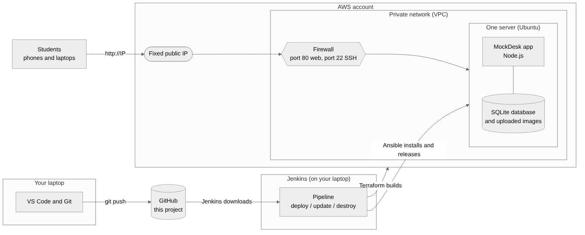
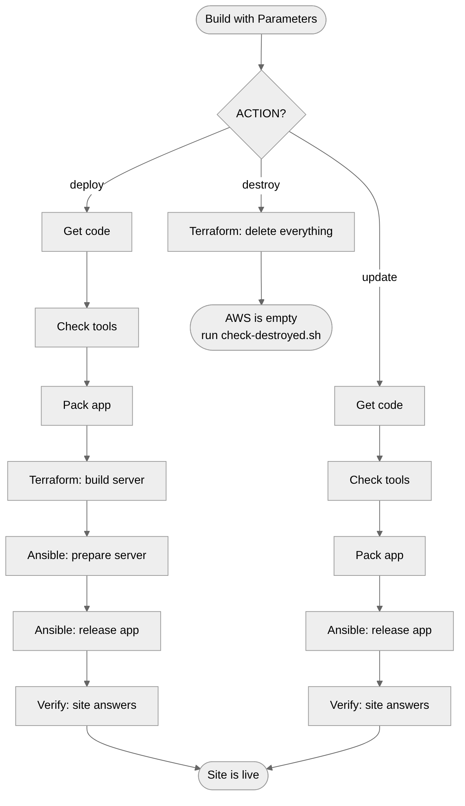
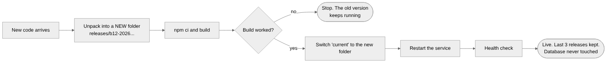
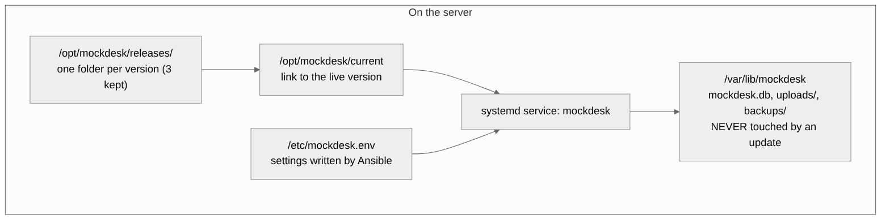
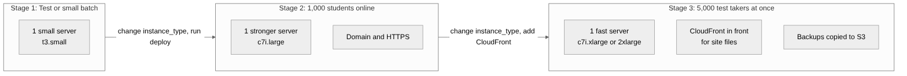

# 01 · The infrastructure

MockDesk runs on **one server** on AWS. That server holds the Node.js app, the website files and the SQLite database.
Everything is built by **Terraform** (the server and network), set up by **Ansible** (Node.js and the app), and started by one click in **Jenkins**.

## The big picture

Read it from the bottom left:
1. You change the app in VS Code and `git push` to GitHub.
2. Jenkins downloads the project from GitHub when you press **Build**.
3. Terraform builds the AWS parts. Ansible installs Node.js and the app on the server.
4. Students open `http://<fixed IP>`. The firewall lets only web (port 80) and SSH (port 22) in.

## The three buttons

| ACTION | What happens | Time |
|---|---|---|
| `deploy` | builds the AWS server, firewall and fixed IP, then installs and starts the app. Safe to run again: only changes are applied | 8 to 10 min |
| `update` | puts your new code on the existing server. Student data is kept | about 2 min |
| `destroy` | deletes everything on AWS (server, disk, IP, network, key) | 3 to 5 min |

## What Terraform builds

| Piece | Details |
|---|---|
| Server | 1 × `t3.small` (2 GB memory), 20 GB gp3 disk, Ubuntu 22.04. Change the size in `terraform/variables.tf` |
| Network | its own VPC `10.20.0.0/16` with one public subnet and an internet gateway |
| Fixed IP | an Elastic IP, so the link stays the same if the server restarts |
| Firewall | port 80 (website) from anywhere, port 22 (SSH) from anywhere. SSH still needs the key file |
| SSH key | made by Terraform, saved in `keys/mockdesk-demo.pem` (never committed to Git) |
| Tags | every resource has `Project=mockdesk-demo`, so `scripts/check-destroyed.sh` can find leftovers |

Settings you may change are all in `terraform/variables.tf`: `region`, `instance_type`, `disk_gb`, `allowed_web_cidr`, `allowed_ssh_cidr`.

## How an update is released safely

The new version is built in its own folder first. The site switches to it only after the build worked. If the build fails, the old version keeps running. The last 3 versions are kept.

## Folders on the server

| Path | Contents | Changed by `update`? |
|---|---|---|
| `/opt/mockdesk/releases/<id>/` | one folder per version | a new one is added |
| `/opt/mockdesk/current` | link to the live version | switched |
| `/var/lib/mockdesk/mockdesk.db` | all students, attempts, mocks, settings | **never** |
| `/var/lib/mockdesk/uploads/` | images added by the admin | **never** |
| `/var/lib/mockdesk/backups/` | automatic database backups (see Admin > Data and backup) | **never** |
| `/etc/mockdesk.env` | server settings written by Ansible (port, mode, optional email) | rewritten by `deploy` |

## Why one server, and no database service?
MockDesk keeps its data in a SQLite file. That is simple and cheap, but it means the app must run as **one copy next to its disk**.
You cannot put several servers behind a load balancer. To handle more students you give the one server a faster CPU (see `03-COST-GUIDE.md`, section 4).

## Test mode and live mode
The service starts in test mode (`app_env: development` in `ansible/roles/mockdesk/defaults/main.yml`):
- It works over plain HTTP.
- With no email or SMS provider, the one-time code is printed in the server log. **Password sign-in always works**, so you can test by creating an account with an email and a password.
- Do **not** use test mode for real students. For them you need HTTPS and a real email provider. Follow `05-GO-LIVE-CHECKLIST.md`.

## What the app manages from its own Admin page
Settings that change often are **not** in this kit. Open `http://<ip>/admin` and use: Settings (site name, support contact, sign-in options, referral, limits),
Notifications, Messages, Exams, Mocks, Data and backup, and Users (roles and access). Only the server itself (size, region, email provider keys, domain) is set here.
