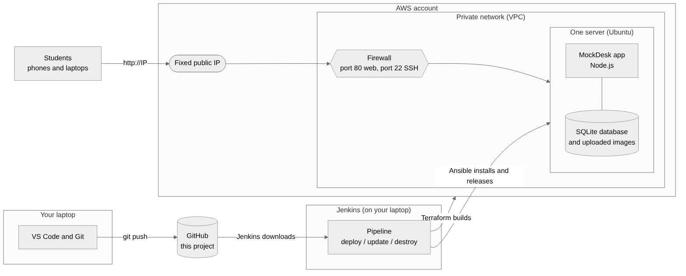

# 03 · Cost guide: what will it cost?

This guide answers one question: **"If I want X, which server do I pick and what will I pay per month?"**
Every number is a monthly cost in US dollars and Indian rupees. Read the short answer first, then the details.

> **Prices were checked on 21 November 2026 and change often.** Rupee values use **₹94 per US dollar**.
> Taxes (GST) are not included unless written. Before you commit money, confirm on the AWS Pricing Calculator
> (https://calculator.aws) and the provider's own price page. Items marked *(estimate)* could not be confirmed.

---
## 1. The short answer

| What you want | Pick this server | Server + disk + IP, per month | Add email OTP (1 lakh/month) |
|---|---|---|---|
| Test the kit, a few friends | `t3.small` | **$22 (₹2,050)** | not needed (use password sign-in) |
| A class or small institute, up to about 200 students online | `t3.medium` | **$41 (₹3,800)** | +$10 (₹940) |
| **1,000 students online at once** | `c7i.large` | **$75 (₹7,050)** | +$10 (₹940) |
| **5,000 students taking a test at once** | `c7i.xlarge` (or `c7i.2xlarge` to be safe) | **$145 (₹13,600)** / $275 (₹25,900) | +$10 (₹940) |
| 5,000 test takers, but only on exam days | `c7i.2xlarge` for the exam days only, small server otherwise | about **$26 (₹2,400)** for 3 exam days + $22 for the rest | +$10 |

**Sending 1 lakh (100,000) sign-in codes a month by email costs only about $10 (₹940)** with Amazon SES.
The same number of codes by SMS costs ₹16,000 to ₹29,500 in India, and over ₹7 lakh with Twilio. Email is 20 to 800 times cheaper.

---
## 2. How the cost is made: every component

The kit runs **one server**. Your monthly bill is that server plus a few small things.

### 2.1 The server (the big part)
Region **Mumbai (ap-south-1)** is closest to Indian students. US East (N. Virginia) is a little cheaper for the small types.
Prices are for Linux, on demand, running all month (730 hours).

| Server | CPU / memory | Mumbai per month | N. Virginia per month | Good for |
|---|---|---|---|---|
| `t3.small` | 2 / 2 GB | $16 (₹1,540) | $15 | testing only |
| `t3.medium` | 2 / 4 GB | $33 (₹3,070) | $30 | up to ~200 online |
| `t3.large` | 2 / 8 GB | $65 (₹6,150) | $61 | a stronger `t3`, still shared CPU |
| `t3.xlarge` | 4 / 16 GB | $131 (₹12,300) | $121 | not recommended: shared CPU |
| `c7i.large` | 2 / 4 GB | $65 (₹6,120) | $65 | ~1,000 online |
| `c7i.xlarge` | 4 / 8 GB | $130 (₹12,250) | $130 | ~5,000 test takers |
| `c7i.2xlarge` | 8 / 16 GB | $261 (₹24,500) | $261 | 5,000+ with a big safety margin |
| `m7i.xlarge` | 4 / 16 GB | $155 (₹14,550) | $147 | if you need more memory |

**Why `c7i` and not `t3` for real traffic?** A `t3` server is "burstable": it is fast only while it has saved-up credits. A long exam
uses the CPU steadily, so credits run out and the server slows down (or AWS charges extra in *unlimited* mode). A `c7i` server is fast all the time.

**Why not more cores?** MockDesk's Node.js server uses **one CPU core** for its work. A faster core helps more than many cores. The extra cores are used by the operating system, compression and the database writes. That is why the table jumps by price, not by core count.

**Cheaper by committing:** a 1-year Savings Plan or reserved server is usually about 30 to 40% cheaper *(estimate, check the calculator)*. Only do this after the site is stable.

### 2.2 The small parts

| Part | Price | Notes |
|---|---|---|
| Disk (EBS gp3) | about $0.09 per GB-month *(estimate for Mumbai; $0.08 in N. Virginia)* | 20 GB is enough to test. 50 to 100 GB for a real site with images and backups. 100 GB = $9 (₹850) |
| Public IP address | $3.65 (₹343) per month | AWS charges $0.005 per hour for every public IPv4 address |
| Data out to the internet | first 100 GB free each month, then $0.109 per GB in Mumbai | see section 4: even 5,000 test takers use only a few GB |
| Domain name (`.com`) | about $10 to $14 per year (₹1,000 to 1,300) | Cloudflare charges $10.44 a year, no markup |
| DNS (Route 53) | $0.50 per month | free if the domain registrar's DNS is used |
| HTTPS certificate | **free** | Let's Encrypt (on the server) or AWS ACM (with CloudFront or a load balancer) |
| Backups in S3 | $0.025 per GB-month | 10 GB of backups = $0.25 (₹24) |
| CloudFront (speeds up site files) | first 1 TB out and 10 million requests free each month | usually **$0** at this size |
| Load balancer (ALB) | about $22 (₹2,100) per month minimum *(computed from the N. Virginia rate)* | **not needed** for one server. Only add it if you also want AWS to handle HTTPS |
| Web firewall (AWS WAF) | $5 + $1 per rule per month + $0.60 per million requests | optional |
| Monitoring (CloudWatch) | free for 10 alarms and 5 GB of logs | enough |

### 2.3 Sending codes and messages

| Channel | Price | 1 lakh messages | Notes |
|---|---|---|---|
| **Email via Amazon SES** | $0.10 per 1,000 (pay as you go) or $0.16 per 1,000 (new Essentials plan) | **$10 to $16 (₹940 to ₹1,500)** | cheapest. Needs a verified domain and a request to leave the SES sandbox |
| Email via Zoho ZeptoMail | about $25 per 100,000 *(estimate)* | ~$25 (₹2,350) | simple setup |
| Email via Resend | $35 per month for 100,000 | $35 (₹3,300) | easy for developers |
| Email via Mailgun | $75 per month for 100,000 | $75 (₹7,050) | |
| Email via Brevo | free plan is only 300 per day (9,000 a month). Paid plans start at $9 | one lakh is not on the free plan | |
| Gmail / personal SMTP | free | **not possible** | Gmail stops at about 500 messages a day |
| SMS via MSG91 | ₹0.16 to ₹0.25 per SMS, plus 18% GST, plus a one-time DLT registration | ₹18,900 to ₹29,500 | needs a DLT-approved template in India |
| SMS via Twilio to India | $0.0832 per SMS | **$8,320 (₹7.8 lakh)** | far more expensive than local providers |
| WhatsApp (Meta), utility or sign-in message | ₹0.115 per message | ₹11,500 | needs a Meta-approved template and a provider account |
| WhatsApp marketing message | ₹0.8631 per message | ₹86,310 | for promotions only. 10,000 messages = ₹8,631 |
| Browser push notifications | free | ₹0 | works only over HTTPS |

---
## 3. Scenarios: what to run and what it costs

All scenarios use Mumbai prices, one server, one fixed IP, and a gp3 disk.

### Scenario A · Test and demo (what the kit builds today)
`t3.small`, 20 GB, no domain, plain HTTP, password sign-in.

| Item | $ per month | ₹ per month |
|---|---|---|
| `t3.small` | 16.35 | 1,540 |
| 20 GB disk | 1.80 | 170 |
| public IP | 3.65 | 340 |
| **Total** | **21.80** | **2,050** |

Running it for one day only costs about **$0.73 (₹70)**. Destroy it when you finish.

### Scenario B · A class or small institute (up to about 200 students online)
`t3.medium`, 30 GB, a domain, HTTPS, SES email codes.

| Item | $ | ₹ |
|---|---|---|
| `t3.medium` | 32.70 | 3,070 |
| 30 GB disk | 2.70 | 250 |
| public IP | 3.65 | 340 |
| domain (per month) | 1.00 | 95 |
| DNS | 0.50 | 47 |
| email codes, 20,000 a month | 2.00 | 190 |
| **Total** | **42.55** | **≈ 4,000** |

### Scenario C · 1,000 students online at once
Think of 1,000 students browsing the dashboard, reading results and starting tests, with only some taking a test at that moment.
`c7i.large`, 50 GB, a domain, HTTPS, S3 backups, SES email codes (1 lakh a month).

| Item | $ | ₹ |
|---|---|---|
| `c7i.large` | 65.12 | 6,120 |
| 50 GB disk | 4.50 | 420 |
| public IP | 3.65 | 340 |
| domain + DNS | 1.50 | 140 |
| S3 backups (10 GB) | 0.25 | 24 |
| **Infrastructure** | **75.02** | **≈ 7,050** |
| email codes, 1 lakh through SES | 10.00 | 940 |
| **Total** | **85** | **≈ 7,990** |

### Scenario D · 5,000 students taking a test at the same time
`c7i.xlarge`, 100 GB, a domain, HTTPS, CloudFront for the site files, S3 backups.

| Item | $ | ₹ |
|---|---|---|
| `c7i.xlarge` | 130.31 | 12,250 |
| 100 GB disk | 9.00 | 850 |
| public IP | 3.65 | 340 |
| domain, DNS, CloudFront (free tier), S3 | 2.00 | 190 |
| **Infrastructure** | **144.96** | **≈ 13,630** |
| email codes, 1 lakh through SES | 10.00 | 940 |
| **Total** | **155** | **≈ 14,570** |

**With a big safety margin** (`c7i.2xlarge`): infrastructure **$275 (₹25,900)**, total about $285 (₹26,800).
Pick this if a failure during a paid live exam would be very costly.

### Scenario E · A big live exam only on a few days (cheapest way to be safe)
Keep a small server most of the time and use a big one only when the exam runs.

| Item | $ | ₹ |
|---|---|---|
| small `t3.medium` all month | 40 | 3,760 |
| `c7i.2xlarge` for 72 extra hours (3 days) | 25.70 | 2,420 |
| **Total** | **≈ 66** | **≈ 6,200** |

How: change `instance_type` in `terraform/variables.tf`, push to GitHub, run **deploy**. Terraform stops the server, changes its size and starts it again in a few minutes. **Do this the day before, not during the exam.** Your data stays on the disk. Change it back after the exam.

### Scenario F · What the sign-in channel does to the bill (same 5,000-test-taker server, 1 lakh codes)

| Sign-in codes by | Messages cost | Whole bill |
|---|---|---|
| Email (SES) | $10 (₹940) | ≈ ₹14,570 |
| WhatsApp sign-in message | ₹11,500 | ≈ ₹25,100 |
| SMS (MSG91, with GST) | ₹18,900 to ₹29,500 | ≈ ₹32,500 to ₹43,100 |
| SMS (Twilio to India) | ₹7.8 lakh | ≈ ₹8 lakh |

**Tip:** let students sign in with a password after the first time, and use codes only for sign-up and "forgot password". That can cut the number of codes by more than half.

---
## 4. Will it be fast enough? How these sizes were chosen

We measured the app on a 2-core test machine, with the load generator running on the same machine. These are estimates for planning, not promises. Measured on 21 November 2026:

| Measured | Result |
|---|---|
| Saving a student's answers (40 answers per save) | about **540 saves per second** per Node process |
| Opening a test (loading its state) | about 600 per second |
| Dashboard (list of mocks) | about 530 per second |
| Starting a test | about 5 ms each |
| Submitting a section or the whole test | about 9 ms each |
| Opening the full result page | about 23 ms, 258 KB (about 48 KB after compression) |

What this means:

| Situation | Load it creates | Fits in |
|---|---|---|
| 1,000 students on the dashboard, one click every ~8 seconds | ~125 requests per second | one fast core (`c7i.large`) at about 25% |
| 5,000 students taking a test, one saved answer about every 45 seconds | ~110 saves per second, peaks of about 300 | `c7i.xlarge`, about 20% busy on average, about 55% at peaks |
| 5,000 students **finish at the same minute** | 5,000 submissions + 5,000 result pages = about 3 minutes of one core's work | students wait up to a few minutes for results. Use a live-exam window with results released after it closes, or `c7i.2xlarge` |

These tests used the built-in five mocks without images. Questions with images or long passages make pages bigger, so rehearse with your own content.
Data sent to students is small: well under 1 MB per student per test, so even 5,000 test takers use **under 5 GB**, which is inside the free 100 GB.

**The honest limit.** The database is a single file (SQLite), so MockDesk runs as **one server**. You cannot add a second server behind a load balancer. To go beyond about 5,000 to 10,000 test takers at the same moment, the app would need a different database. Until then, scaling means a faster server. Always run a rehearsal before a large live exam: create test accounts, start tests on a phone and a laptop, and watch Admin > System.

---
## 5. Ways to spend less

1. **Destroy test setups** when you finish (Jenkins `destroy`, then `./scripts/check-destroyed.sh`).
2. Use the **smallest server that passes a rehearsal**. Upgrade only before big exams (scenario E).
3. Prefer **email codes over SMS**. Use password sign-in for returning students.
4. After the site is stable for a few months, buy a **1-year Savings Plan** for the base server.
5. Keep **backups small**: the app keeps the last 7 copies (change it in Admin > Data and backup). Copy them to S3 (cost: cents).
6. Use **CloudFront** (free tier) once you pass 1,000 students, so site files are served from a nearby location.

## 6. Other hosts (cheaper, simpler)
AWS **Lightsail** has fixed monthly prices with transfer included: 2 GB $12, 4 GB $24, 8 GB $44, 16 GB $84, 32 GB $164. It is cheaper than `t3` for small sites,
but the plans are burstable shared-CPU machines. This kit builds on normal EC2 servers, so Lightsail would need a different Terraform file.

## 7. Where the numbers come from
EC2 prices: DoiT and aws-pricing.com (cross-checked). AWS: aws.amazon.com pricing pages for EBS, public IPv4, CloudFront, Route 53, ACM, ALB, SES, Lightsail. Email: provider price pages (Resend, Mailgun, Brevo, ZeptoMail via Capterra).
SMS: richautomate.in (MSG91, Fast2SMS), twilio.com. WhatsApp: Meta documentation and myoperator.com (secondary, check before use). Exchange rate: HDFC Sky, 13 November 2026.
**Could not confirm:** Mumbai prices for the disk, load balancer and S3 requests, the `c7i.4xlarge` price, the Savings Plan rate, ZeptoMail per-credit price, MSG91 DLT fee.
